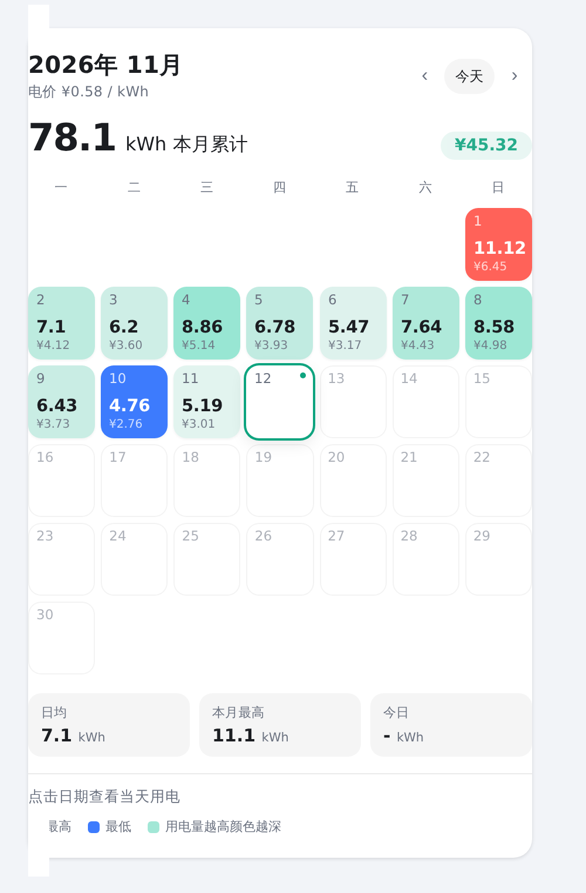

# Energy Calendar Card

按**月历**显示每日用电量和电费的 Home Assistant 自定义卡片，外观接近网上国网 App 的「用电日历」。

数据取自 HA 的**长期统计**（`recorder/statistics_during_period`，`period: day`），因此和能源面板的数字完全一致。



## 特性

- 月历格子：每天显示 kWh 与电费，点击查看当天明细
- 热力着色：用电越多颜色越深；当月最高/最低单独标色
- 顶部大数字显示本月累计电量与电费
- 底部统计：日均、本月最高、今日
- 自动适配浅色/深色主题
- 左右翻月，一键回到今天

## 安装

1. 把仓库根目录的 `energy-calendar-card.js` 复制到 HA 的 `config/www/energy-calendar/` 目录
   （没有 `www` 目录就新建）
2. 设置 → 仪表板 → 右上角 ⋮ → 资源 → 添加资源
   - URL：`/local/energy-calendar/energy-calendar-card.js`
   - 类型：JavaScript 模块
3. 刷新浏览器

## 配置

```yaml
type: custom:energy-calendar-card
entities:
  - entity: sensor.esp32_c5_2_pzem_energy   # 累计型 energy 实体（total_increasing）
price: 0.58          # 每 kWh 电价，留空则不显示电费
currency: ¥          # currency: "¥"
title: 电量电费       # 可选，默认「2026年 11月」
```

多个实体会被**按天求和**，对应能源面板里把多个来源合并成一条电网。

### 全部选项

| 选项 | 默认 | 说明 |
| --- | --- | --- |
| `entities` | 必填 | `[{entity, name?, unit?, multiplier?}]` 或字符串数组 |
| `price` | 无 | 每 kWh 单价；为数字才显示电费 |
| `currency` | `¥` | 货币符号 |
| `show_cost` | 跟随 `price` | 强制显示/隐藏电费 |
| `unit` | `kWh` | 展示单位（数据会自动从 Wh/MWh/GJ 换算） |
| `decimals` | `2` | 小数位，末尾 0 会省略 |
| `week_start` | `monday` | `monday` / `sunday` |
| `tint` | `true` | 是否按用电量热力着色 |
| `max_color` / `min_color` | 红 / 蓝 | 当月最高/最低的颜色 |
| `accent_color` | 青绿 | 热力色与「今天」标记的主色 |

## 说明

- 只支持 `state_class: total_increasing` 的累计电量实体（`device_class: energy`）
- 当天数据由 recorder 按小时汇总，HA 默认约 5 分钟更新一次统计，卡片每 5 分钟拉取一次
- 电费 = 日电量 × `price`，不做阶梯电价/峰谷计价；需要的话可以换成用 HA 的电价实体配合能源面板
